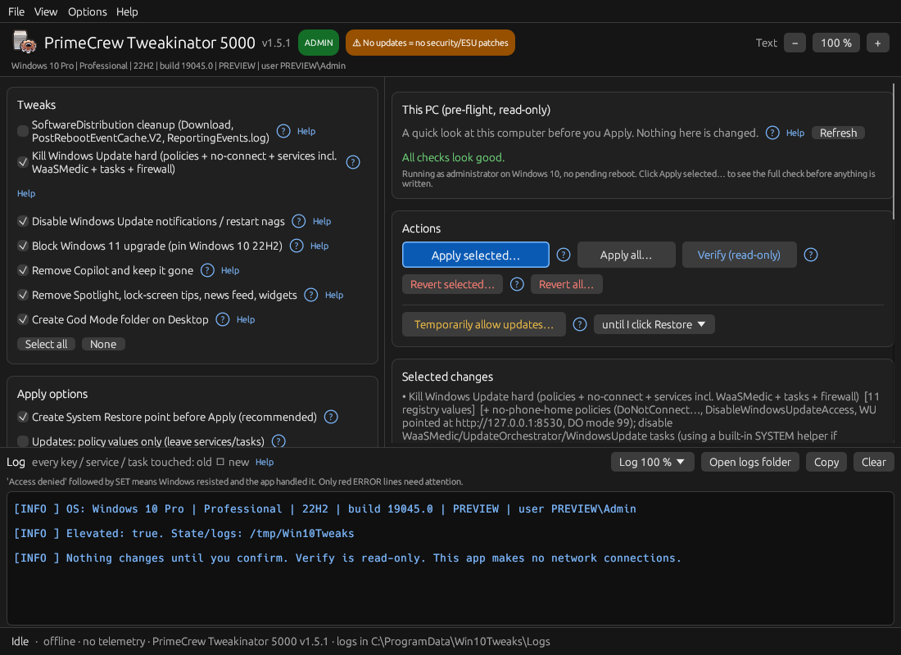
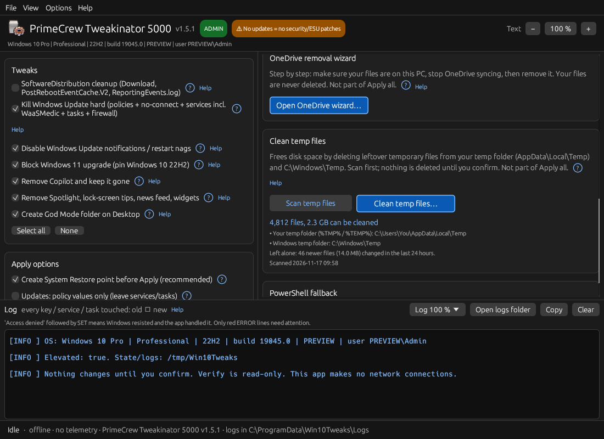
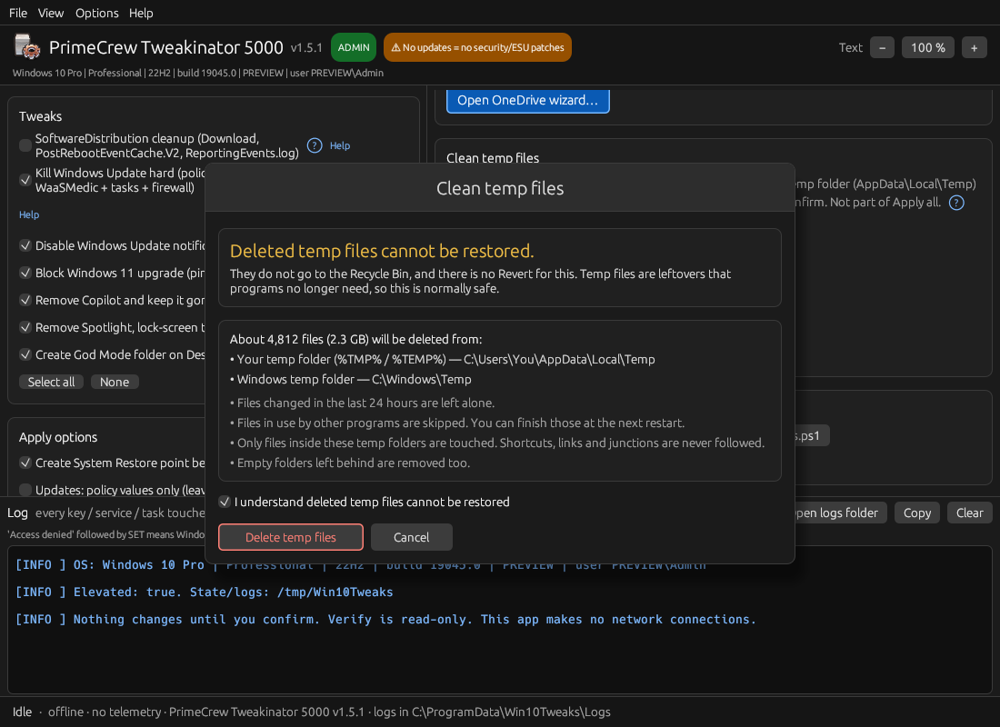
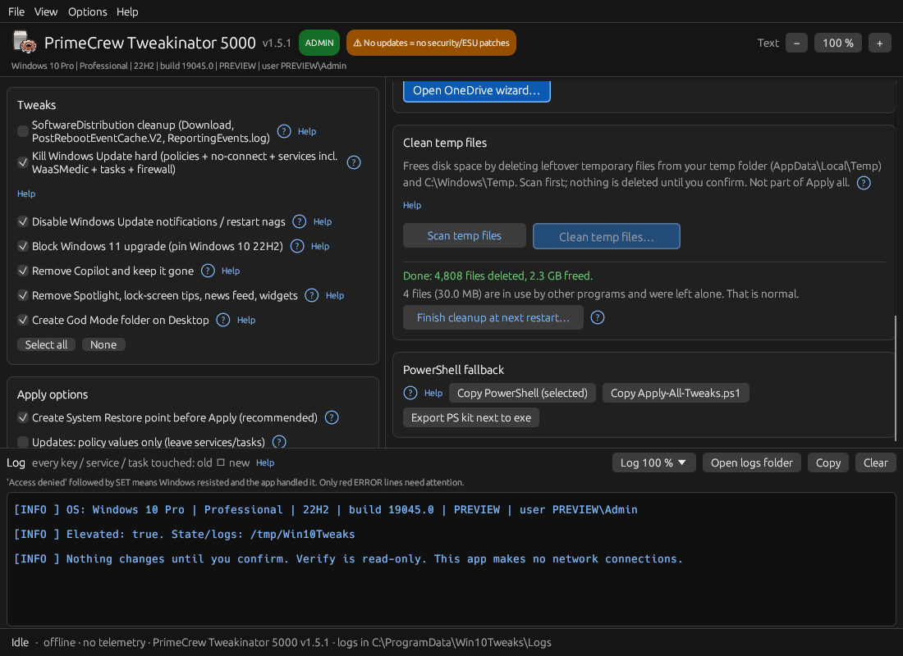

# PrimeCrew Tweakinator 5000

PrimeCrew Tweakinator 5000 is a small Windows 10 utility from **PrimeCrew Software**. It lets you apply a handful of conservative tweaks — nothing changes until you confirm, and you can **Verify** or **Revert** anytime.



## Download

Get the latest files from the **[Releases page](https://github.com/primecrew/primecrew-tweakinator-5000/releases/latest)** (no GitHub account needed). The current release is **v1.5.1**.

- **Installer version (recommended)** — [PrimeCrewTweakinator5000-v1.5.1-x64-Setup.exe](https://github.com/primecrew/primecrew-tweakinator-5000/releases/download/v1.5.1/PrimeCrewTweakinator5000-v1.5.1-x64-Setup.exe)  
  A normal setup. It adds a Start menu entry under PrimeCrew Software and appears in Add/Remove Programs.

- **Portable version (no install) — [PrimeCrewTweakinator5000-v1.5.1.zip](https://github.com/primecrew/primecrew-tweakinator-5000/releases/download/v1.5.1/PrimeCrewTweakinator5000-v1.5.1.zip)**  
  Unzip anywhere, run `PrimeCrewTweakinator5000.exe`. Nothing gets installed, and you can run it from a USB stick.

**Requirements:** Windows 10 64-bit (aimed at Pro 22H2). The app asks for administrator permission (a UAC prompt) when you run it. The GUI needs a GPU/driver with OpenGL 2+ (normal on real hardware; may fail in a bare VM or some RDP sessions). No extra runtime. The app contains no network code and sends no telemetry.

The exe is unsigned, so Windows SmartScreen may say “Windows protected your PC.” Click **More info**, then **Run anyway**.

**Installer details:** the setup is 64-bit only. The app is installed to `C:\Program Files\PrimeCrew Software\PrimeCrew Tweakinator 5000\`. An upgrade removes previous shortcuts first so they do not duplicate.

**Portable details:** unzip and run `PrimeCrewTweakinator5000.exe` from any folder (for example `C:\Apps\PrimeCrewTweakinator5000\` or a USB stick).

**Uninstall:** use Add/Remove Programs or `uninstall.exe` in the install folder. Uninstalling removes the app, its Start menu shortcut, and the Add/Remove Programs entry. It does **not** revert any tweaks you applied, and it does **not** delete logs, recorded originals, or backups under `C:\ProgramData\Win10Tweaks`. Revert stays an in-app action: if you want your previous Windows settings back, run the app and click **Revert** before uninstalling. The uninstaller also shows this note. The **PrimeCrew Software** Start menu folder is removed only if it is empty. The parent `C:\Program Files\PrimeCrew Software` folder is left in place if other PrimeCrew Software apps are installed there.

**Compatibility:** state, logs and backups stay under `C:\ProgramData\Win10Tweaks\` (logs in `Logs\`, state in `state.json`, UI prefs in `ui.json`, temporary-allow state in `tempallow.json`, temp files scheduled for the next restart in `tempclean-pending.json`). Scheduled task and firewall rule names still use the `Win10Tweaks-*` prefix, so this release continues to manage tweaks applied by earlier builds. Version history is in [CHANGELOG.md](CHANGELOG.md).

## What it is

A portable, offline, admin-only GUI (Rust, eframe/egui) for a small set of Windows 10 tweaks, with the same actions available as PowerShell scripts. It is not a "tweaker" that silently writes dozens of undocumented keys. Each tweak is listed, confirmed, logged (old → new), and can be verified or reverted.

## What it does

You tick the tweaks you want, review the exact changes, and confirm. The default path creates a System Restore point first (Apply aborts if that fails while the box is ticked). Afterward you can **Verify** (read-only PASS / FAIL / WARN) or **Revert** (restores the values recorded in `state.json`). A **Copy PowerShell** button puts an equivalent self-contained script on the clipboard, and **Export PS kit** writes the script folder next to the exe.

The OneDrive removal wizard and **Clean temp files** are separate, guided tools. Neither is ever part of Apply all.

## Feature summary

### Hard Windows Update kill, Temporary allow, and Restore kill

**Kill Windows Update hard** (default; the conservative **policy only** option skips services, tasks, the firewall and the no-connect policies):

- Policies: `NoAutoUpdate=1`, `AUOptions=1`, `NoAutoRebootWithLoggedOnUsers=1`, `SetDisableUXWUAccess=1` (hides *Check for updates*), Store `AutoDownload=2`.
- No phone home: `DoNotConnectToWindowsUpdateInternetLocations=1` and `DisableWindowsUpdateAccess=1`. Microsoft documents that both apply only when an intranet update server is set, so `WUServer` / `WUStatusServer` are set to `http://127.0.0.1:8530` (a local address that serves nothing) and `AU\UseWUServer=1`. Delivery Optimization: `DODownloadMode=99`.
- Services `wuauserv`, `UsoSvc`, `WaaSMedicSvc` and `uhssvc` (if installed) are set to Start=4 and stopped. If a normal write is refused, the app takes ownership of the **service registry key only** (never a file or binary). For `WaaSMedicSvc` it also adds a deny ACE so SYSTEM cannot Set Value on that one key. The original owner and SDDL are saved in `state.json`. No `sc sdset`, no replaced binaries.
- Protected tasks under `\Microsoft\Windows\WaaSMedic\`, `\UpdateOrchestrator\` and `\WindowsUpdate\` are disabled, using a temporary SYSTEM task `\Win10Tweaks\Win10Tweaks-SysHelper` when an administrator is refused.
- Outbound firewall rules `Win10Tweaks-NoWU-{wuauserv,UsoSvc,WaaSMedicSvc,uhssvc}`.

Side effects: no cumulative or consumer-ESU patches, no Store installs or updates, no Features on Demand / .NET 3.5 installs, Defender definitions not via Windows Update (use `Update-MpSignature -UpdateSource MMPC`), and the Settings ▸ Windows Update page may be blank.

**Temporarily allow updates** lifts only what the Microsoft Store needs: the no-connect and dummy-server policies, the `Win10Tweaks-NoWU-*` firewall rules, and `wuauserv` / `UsoSvc`. `NoAutoUpdate` and the WaaSMedic lock stay, so Windows does not auto-install OS updates in the window. Durations: until you click **Restore update kill**, or 30 / 60 / 120 minutes. State is in `C:\ProgramData\Win10Tweaks\tempallow.json`. A timed allow also registers a one-shot SYSTEM task `\Win10Tweaks\Win10Tweaks-RestoreWUKill`. When the app is running from the installed location, that task points at the installed exe. When it is running as a portable copy, the exe is staged at `C:\Program Files\Win10Tweaks\win10_tweaks.exe` (the same path earlier builds used) so SYSTEM never runs a user-writable file, and a timer created by an older build still fires. **Restore update kill** re-applies Updates exactly like Apply, and clears the task and any staged copy (it never deletes the installed exe).

WinGet packages from the `winget` source (for example PowerToys) usually update without lifting the kill. Microsoft Store / `msstore` apps (for example the ChatGPT app) need Temporary allow.

### Verify and Revert

**Verify** is read-only and reports PASS / FAIL / WARN for every setting. With the hard kill, it **FAIL**s on gaps (a service not Start=4, a missing no-connect policy, an unlocked WaaSMedicSvc key, or a missing firewall rule).

**Revert** restores recorded originals (policies, service start types, the WaaSMedicSvc key owner and SDDL, tasks, firewall rules). It cannot recreate an unknown prior state and does not reinstall removed apps.

### Windows 11 upgrade block (pinned to 22H2)

`TargetReleaseVersion=1`, `ProductVersion="Windows 10"`, `TargetReleaseVersionInfo="22H2"` (22H2 is the final Windows 10 release), `DisableOSUpgrade=1`, plus `AllowOSUpgrade=0` and the Store `DisableOSUpgrade=1` policy.

### Copilot removal

Policies `TurnOffWindowsCopilot=1` (HKCU and HKLM), hide the taskbar button, disable the Edge Copilot sidebar, stop Copilot processes, and remove the `Microsoft.Copilot` Appx (and `Microsoft.MicrosoftOfficeHub` unless you tick "keep Microsoft 365"). Provisioned packages are removed and a Deprovisioned key is written so updates are less likely to put it back.

### Lock screen Spotlight, widgets and news

Content Delivery Manager values, CloudContent policies, Feeds / widgets / news-and-interests policies, and the taskbar Widgets button. CloudContent Spotlight policies are scoped by Microsoft to Enterprise/Education; on Pro the ContentDeliveryManager values do the real work (Verify may WARN on those policies).

There is no documented registry switch for the Windows 10 lock-screen Weather / Daily Wonder cards (2025+). One-time manual fix: Settings ▸ Personalization ▸ Lock screen → Background = *Windows spotlight* → status/widget app = *None* → Background back to *Picture*.

### SoftwareDistribution cleanup

Optional and unticked by default. Deletes only `Download\*`, `PostRebootEventCache.V2\*` and `ReportingEvents.log` under `SoftwareDistribution`. Never touches `DataStore`. Refuses if a reboot is pending or TrustedInstaller is running (override is available, not recommended).

### God Mode

Creates a God Mode folder on the running account's Desktop (`God Mode.{ED7BA470-8E54-465E-825C-99712043E01C}`).

### OneDrive removal wizard (beginner and Expert modes)

A step-by-step wizard, never part of Apply all. **Your files are never deleted**; the OneDrive folder stays on the PC.

1. **Check files** (read-only): installation, linked accounts, OneDrive folders, whether Desktop / Documents / Pictures (and Music / Videos / Downloads) still point into OneDrive, and how many files are cloud-only. Helpers: open OneDrive, open the folder, **Download all files to this PC**, **Copy my folders back** (copy only, never deletes; name conflicts are skipped and logged). Next stays disabled while a known folder is in OneDrive or any file is cloud-only. Beginners can skip the check only through a separate warning with a required tick. A mismatch between the elevated account and the signed-in user can never be overridden; the wizard is locked.
2. **Stop sync**: guided Unlink this PC, then (after a confirm) close OneDrive, remove the Run entry, disable `OneDrive*` scheduled tasks. All recorded.
3. **Remove** (warning + required tick): optional restore point, uninstall (`OneDriveSetup.exe`, `winget` only as a last resort), block policies, optionally hide the Explorer side-bar entry and stop new user accounts getting OneDrive. Then a finish screen with Undo instructions.

**Undo** restores every recorded value and explains how to reinstall OneDrive. It does not move folders back into OneDrive.

**Expert mode** (Options, off by default, saved in `ui.json`): skips the welcome screen and the explanations / (i) tips, and shows registry paths, attrib flags and counts. It keeps the files gate, every destructive confirm, and all Apply / Revert confirmations.

### Clean temp files



Its own card on the main window, never part of Apply all, and there is no Revert for it.

1. **Scan temp files** (read-only) counts what could be cleaned, for example “4,812 files, 2.3 GB can be cleaned”. By default it looks at the two usual places: your own temp folder (`%TMP%` / `%TEMP%`, normally `AppData\Local\Temp`) and `C:\Windows\Temp`. Your `%TMP%` / `%TEMP%` is cleaned only when it is the standard `AppData\Local\Temp`; if it points to a custom folder, it is left alone and the card shows a note. Expert mode can also add other user accounts' `AppData\Local\Temp` folders, leave out `C:\Windows\Temp`, and change the age limit.
2. **Clean temp files…** opens a confirm window that says plainly that **deleted temp files cannot be restored** (no Recycle Bin, no undo) and needs a tick. Then the app deletes what it can.
3. Files that another program has open (mouse or keyboard software, Teams, a browser, a running installer) are skipped quietly and counted, not reported as errors. In Beginner mode their names go to the log file only; Expert mode also shows them on screen with the Windows reason.
4. Optional **Finish cleanup at next restart…** hands just those leftover files to Windows' own delete-at-restart list (`MoveFileExW` with `MOVEFILE_DELAY_UNTIL_REBOOT`, stored in `PendingFileRenameOperations`). Windows deletes them early in startup, before services and programs start. What was scheduled is recorded in `C:\ProgramData\Win10Tweaks\tempclean-pending.json`, so after the restart the card shows how many files were cleared and how much space came back. **Cancel scheduled cleanup…** removes only this app's entries from that list before you restart.



Safety rules: files and folders changed in the last 24 hours are left alone (Expert: 1 hour, 3 days, or 7 days). Only paths strictly inside the temp folders are touched; symbolic links, junctions and other reparse points are never followed or deleted. A folder is used only if it is named `Temp` / `Tmp` and is not the top of a drive, and your own temp folder only if it is the standard `AppData\Local\Temp`, so a custom `TEMP` setting such as `C:\` or `D:\Scratch` is left alone. The folder the app is running from is never touched. Empty folders left behind are removed. The scan is only a preview: Clean checks everything again as it runs. Until you restart after scheduling, the pre-flight check reports a pending reboot.



### Menu bar, Help, and About

A classic menu bar sits across the top:

- **File** — Copy PowerShell script, Open logs folder (`C:\ProgramData\Win10Tweaks\Logs`), Exit.
- **View** — Theme (System, Dark, Light, High contrast). Text size stays in the header (and **Ctrl +/−/0**, **Ctrl+wheel**).
- **Options** — Expert mode (off by default, saved in `ui.json`). Apply-time checkboxes (restore point, policy only, keep Microsoft 365, cleanup override) stay in the Apply options card.
- **Help** — Help contents (F1), and **About PrimeCrew Tweakinator 5000…**

The Help window is resizable, with a topic list on the left and readable text on the right. It covers getting started, the pre-flight check, Clean temp files, every tweak (what it changes, why you might want it, risks, and how to undo it — registry lists are generated from the same catalog the app uses), Temporary allow, the OneDrive wizard step by step, themes, the PowerShell fallback, how to read the log, logs and saved state, uninstalling, and known limits. A small “Help” link on each tweak and in the wizard opens the matching topic.

Circled question marks (a “?” inside a circle, not a “(?)” label) sit next to settings, actions and wizard steps. Hover for a short explanation; click to open that Help topic. They are shown in Beginner mode and, more quietly, in Expert mode.

The About popup (Help menu only) shows the app icon, the name, the version from the package metadata, “by PrimeCrew Software”, a one-line description, and “Free for personal use. Use at your own risk — read Help ▸ Known limits,” plus an MIT license note. The repository includes an MIT LICENSE file (copyright PrimeCrew Software). About is no longer listed under Options.

### Pre-flight check, Apply summary, and friendlier logs

Before Apply writes anything, a read-only **pre-flight check** reports (in plain language, with a Help link for each item): whether the app is elevated (with a **Restart as administrator** button if it is not), whether the signed-in account is an administrator, the UAC level (info only — the app never changes UAC), Microsoft Defender Tamper Protection (info; it does not block these tweaks), any third-party antivirus (which may block or quarantine the app — a whitelist tip is shown), a mismatch between the elevated and signed-in accounts, a pending reboot, and whether this is Windows 10 or 11. The same checklist sits on the main window under **This PC**. Nothing in the check is changed automatically.

After Apply, Beginner mode shows a **summary** with counts of changes made, already done (skipped), and real problems, plus next steps (reboot, then Verify). If there were no real problems, it says “Everything worked.” Each real error gets a one-line explanation.

The log has a Beginner-mode legend: “'Access denied' followed by SET means Windows resisted and the app handled it. Only red ERROR lines need attention.” Lines where Windows protects a task or the WaaSMedic service use plain wording; the raw text is kept in the log file and, in Expert mode, on screen in a quieter style. A leftover Store app version that is already gone, a News and interests value that Windows locks, and Windows 11-only widget values on Windows 10 are no longer reported as errors, and Verify does not fail on them.

### Themes

**System** (follows Windows; default), **Dark**, **Light**, and **High contrast**, chosen from **View ▸ Theme**. Text size 75–300 % via the header buttons, **Ctrl +/−/0**, or **Ctrl+wheel**. Log font size is separate. Saved in `ui.json`.

### PowerShell fallback kit

The same tweaks as scripts in this folder (`Apply-All-Tweaks.ps1` / `.cmd`, `Verify-Tweaks.ps1`, `Revert-Tweaks.ps1`, and `scripts\`). Double-click `Apply-All-Tweaks.cmd` for a UAC prompt, or run from an elevated PowerShell window. `-WhatIf` is a dry run. `scripts\Set-UpdateWindow.ps1 -Allow` / `-Restore` is the Temporary allow / Restore kill path (no timer in the script). `scripts\Remove-OneDrive.ps1` is the wizard's script equivalent (read-only check by default). From the GUI: **Copy PowerShell (selected)** and **Export PS kit**.

## Safety notes and known limits

- Windows 10 is past end of support (October 14, 2025). Blocking Windows Update also blocks security and consumer-ESU patches (ESU runs through October 12, 2027), which leaves the PC exposed to unpatched vulnerabilities. Applying the Updates kill requires an explicit "I understand" tick; Apply all needs a second tick.
- After Apply, click Verify, and keep the default restore-point option on.
- A manual MSU or a repair install / in-place upgrade can undo the Updates kill (it rewrites services, tasks and the WaaSMedicSvc key ACL). The SYSTEM-deny ACE on that key can also make a manual cumulative update fail — **Revert the Updates tweak before installing updates by hand**, then re-apply if you still want the kill. Run Verify after any manual update.
- Run the app (or scripts) as the account that uses the PC: HKCU values go to the account that elevates. If you elevate with a different admin account, the header shows a red "RUNNING AS … NOT …" warning and the OneDrive wizard is locked.
- Revert cannot reinstall removed Appx packages (use the Store, after Temporary allow if the kill is on). Cleanup cannot be meaningfully reverted (deleted cache files stay deleted). **Clean temp files** has no undo either: deleted temp files do not go to the Recycle Bin.
- Typical resets after a cumulative update or a Store update: Copilot or ContentDeliveryManager values come back. Fix: Verify, then re-apply (idempotent). Optional: `Apply-All-Tweaks.ps1 -RegisterReapplyTask` re-applies at each logon (don't move the script folder).

## Run the PowerShell kit

| How | What happens |
|---|---|
| Double-click `Apply-All-Tweaks.cmd` | UAC prompt → elevated window runs `Apply-All-Tweaks.ps1` |
| Right-click `Apply-All-Tweaks.ps1` → *Run with PowerShell* | script self-elevates (UAC) |
| Elevated prompt: `powershell -ExecutionPolicy Bypass -File .\Apply-All-Tweaks.ps1` | direct |

Downloaded or zip copies may be blocked: `Get-ChildItem -Recurse | Unblock-File`.

Pick tweaks: `-Updates -Notifications -BlockWin11 -Copilot -Spotlight -GodMode -CleanSoftwareDistribution`. Options: `-PolicyOnly`, `-KeepMicrosoft365App`, `-NoRestorePoint`, `-EnableSystemProtection`, `-RegisterReapplyTask`.

## What gets set

The lists below are the same settings the GUI applies. See the scripts under `scripts\` for the exact writes.

**Updates – hard kill** (`scripts\Disable-AutomaticUpdates.ps1`)

Layer 1 – policies (always): `HKLM\SOFTWARE\Policies\Microsoft\Windows\WindowsUpdate\AU`: `NoAutoUpdate=1`, `AUOptions=1`, `NoAutoRebootWithLoggedOnUsers=1`. `...\WindowsUpdate`: `SetDisableUXWUAccess=1`. `HKLM\SOFTWARE\Policies\Microsoft\WindowsStore\AutoDownload=2`.

Layer 2 – default; skipped with **policy only** / `-PolicyOnly`:

- No phone home as described above (`DoNotConnect…`, `DisableWindowsUpdateAccess`, dummy WSUS, `DODownloadMode=99`). `dosvc` itself is not disabled.
- Tasks: every task in `\Microsoft\Windows\WaaSMedic\`, `\UpdateOrchestrator\`, `\WindowsUpdate\` disabled. Task XML files under `System32\Tasks` are not touched.
- Services (forced): `WaaSMedicSvc`, `uhssvc` (Microsoft Update Health Service from KB4023057 — skipped if not installed), `UsoSvc`, `wuauserv` → Start=4 + stopped, with the WaaSMedicSvc key lock described above.
- Firewall: outbound **Block** rules `Win10Tweaks-NoWU-wuauserv`, `Win10Tweaks-NoWU-UsoSvc`, `Win10Tweaks-NoWU-WaaSMedicSvc`, `Win10Tweaks-NoWU-uhssvc` (group `Win10Tweaks`, service-scoped; no IP/hostname lists). BITS, TrustedInstaller/msiserver, cryptsvc, and Edge/Office updaters are not touched.

**Notifications:** `SetUpdateNotificationLevel=1`, `UpdateNotificationLevel=2`, `RestartNotificationsAllowed2=0`, `ScoobeSystemSettingEnabled=0`, task `USO_UxBroker` disabled.

**Block Windows 11:** as in the feature summary.

**Copilot:** as in the feature summary.

**Spotlight / news / widgets:** `HKCU\...\ContentDeliveryManager` values set to 0 (`RotatingLockScreenEnabled`, `RotatingLockScreenOverlayEnabled`, `SubscribedContent-338387/338388/338389/338393/353694/353696/310093Enabled`, `SystemPaneSuggestionsEnabled`, `SoftLandingEnabled`, `SilentInstalledAppsEnabled`, `PreInstalledAppsEnabled`, `OemPreInstalledAppsEnabled`). CloudContent policies (HKCU: `DisableWindowsSpotlightFeatures=1`, `ConfigureWindowsSpotlight=2`, `...OnActionCenter/OnSettings/WindowsWelcomeExperience=1`, `DisableThirdPartySuggestions=1`, `DisableTailoredExperiencesWithDiagnosticData=1`; HKLM: `DisableWindowsConsumerFeatures`, `DisableSoftLanding`, `DisableCloudOptimizedContent=1`). `EnableFeeds=0`, `ShellFeedsTaskbarViewMode=2`, `AllowNewsAndInterests=0`, `DisableWidgetsOnLockScreen=1`, `TaskbarDa=0`, `EnableDynamicContentInWSB=0`.

**God Mode** and **SoftwareDistribution cleanup:** as in the feature summary.

## Verify

```powershell
.\Verify-Tweaks.ps1                      # PASS / FAIL / WARN per item (read-only)
Get-ItemProperty 'HKLM:\SOFTWARE\Policies\Microsoft\Windows\WindowsUpdate','HKLM:\SOFTWARE\Policies\Microsoft\Windows\WindowsUpdate\AU'
Get-ItemProperty 'HKCU:\Software\Policies\Microsoft\Windows\WindowsCopilot','HKCU:\Software\Microsoft\Windows\CurrentVersion\ContentDeliveryManager'
Get-ItemProperty 'HKLM:\SOFTWARE\Policies\Microsoft\Windows\Windows Feeds'
Get-AppxPackage -AllUsers *Copilot*
Get-Service wuauserv,UsoSvc,WaaSMedicSvc | Select Name,Status,StartType
Get-ScheduledTask -TaskPath '\Microsoft\Windows\UpdateOrchestrator\' | Select TaskName,State
Get-HotFix | Sort InstalledOn -Desc | Select -First 5
gpresult /r
```

`gpresult /r` only lists GPOs; registry-written local policy will not appear as an applied GPO — use the `Get-ItemProperty` lines.

WARN is expected for: CloudContent Spotlight policies on Pro, Win11-only widget values, tasks Windows refuses even to SYSTEM, and lifted items while updates are temporarily allowed.

## Patch manually / revert

```powershell
.\Revert-Tweaks.ps1 -Updates     # full re-enable: services, WaaSMedicSvc key owner+SDDL restored, tasks, firewall rules deleted, policies restored
.\Revert-Tweaks.ps1              # undo everything (restores recorded originals, else deletes our values)
```

Revert order for Updates: cancel any temporary allow / restore task → delete every `Win10Tweaks-NoWU-*` rule → service start types back → original owner + permissions of the WaaSMedicSvc key → tasks re-enabled → policy values restored/deleted. A restore point named "Win10Tweaks - before Apply-All-Tweaks" is created by default on Apply.

## Build

This repository holds **source only**. Built exes, the portable zip and the installer are attached to GitHub Releases, not committed. Every release ships both the installer and the portable zip.

**Linux (this project's usual path):** `scripts/build-release.sh` cross-compiles with llvm-mingw (https://github.com/mstorsjo/llvm-mingw), then builds the portable zip and the NSIS installer (`makensis`). Needs the `x86_64-pc-windows-gnullvm` Rust target and NSIS 3.

```bash
PATH="<llvm-mingw>/bin:$PATH" ./scripts/build-release.sh
```

**Windows:** install Rust (MSVC toolchain, https://rustup.rs). In `app\`:

```bat
build.cmd
```

Output: `app\target\release\PrimeCrewTweakinator5000.exe`.

**Linux cross-compile (exe only):**

```bash
cd app
PATH="<llvm-mingw>/bin:$PATH" cargo build --release --target x86_64-pc-windows-gnullvm
```

Output: `app/target/x86_64-pc-windows-gnullvm/release/PrimeCrewTweakinator5000.exe`.

Release artifacts:

```
PrimeCrewTweakinator5000-v1.5.1-x64-Setup.exe
PrimeCrewTweakinator5000-v1.5.1.zip
  PrimeCrewTweakinator5000/PrimeCrewTweakinator5000.exe
  PrimeCrewTweakinator5000/README.md
```

Every build must carry the version in the window title / About, in the exe version info (`FileVersion` / `ProductVersion`), in the installer filename, and in the zip filename.

## Sources (fetched November 2026)

- https://learn.microsoft.com/en-us/windows/deployment/update/waas-wu-settings (NoAutoUpdate, AUOptions, NoAutoRebootWithLoggedOnUsers; DoNotConnect… needs an intranet server; WUServer / WUStatusServer / UseWUServer)
- https://learn.microsoft.com/en-us/windows/client-management/mdm/policy-csp-update (ProductVersion, TargetReleaseVersion, SetDisableUXWUAccess, UpdateNotificationLevel)
- https://admx.newyard.nl/gpo/display-options-for-update-notifications/ (SetUpdateNotificationLevel / UpdateNotificationLevel registry mapping)
- https://learn.microsoft.com/en-us/windows/whats-new/whats-new-windows-10-version-22h2 , https://learn.microsoft.com/en-gb/windows/release-health/status-windows-10-22h2
- https://www.microsoft.com/en-us/windows/extended-security-updates (consumer ESU through Oct 12, 2027)
- https://learn.microsoft.com/en-us/windows/client-management/manage-windows-copilot (Microsoft.Copilot removal, AppLocker, policy deprecation)
- https://learn.microsoft.com/en-us/windows/client-management/mdm/policy-csp-windowsai (TurnOffWindowsCopilot)
- https://learn.microsoft.com/en-us/windows/application-management/remove-provisioned-apps-during-update (Deprovisioned keys)
- https://learn.microsoft.com/en-us/windows/client-management/mdm/policy-csp-experience , https://learn.microsoft.com/en-us/windows/configuration/windows-spotlight/ (CloudContent, edition scope)
- https://learn.microsoft.com/en-us/windows/client-management/mdm/policy-csp-newsandinterests (Dsh widgets policies)
- https://learn.microsoft.com/en-us/answers/questions/4013378/news-and-interests-keeps-turning-itself-back-on (EnableFeeds)
- https://learn.microsoft.com/en-us/answers/questions/3180457/turn-off-windows-spotlight-fun-facts , https://superuser.com/questions/1327459 (ContentDeliveryManager values — community-documented, not Microsoft policy)
- https://learn.microsoft.com/en-us/answers/questions/5527181/windows-10-showing-me-weather-news-and-other-widge (Win10 lock-screen widgets workaround)
- https://superuser.com/questions/1705378 , https://www.kapilarya.com/windows-update-medic-service-in-windows-10 (WaaSMedicSvc / PerformRemediation — community)
- https://learn.microsoft.com/en-us/windows/client-management/mdm/policy-csp-admx-icm (DisableWindowsUpdateAccess, intranet-only note)
- https://learn.microsoft.com/en-us/troubleshoot/mem/configmgr/os-deployment/check-online-updates-unavailable (DoNotConnect… registry value)
- https://learn.microsoft.com/en-us/windows/client-management/mdm/policy-csp-deliveryoptimization (DODownloadMode 99)
- https://support.microsoft.com/en-us/servicing/os/windows-10/2020/11/kb4023057-update-health-tools-windows-update-service-components (uhssvc)
- https://learn.microsoft.com/en-us/archive/msdn-technet-forums/8706fda2-f7cd-4dab-814b-72283b17c423 , https://learn.microsoft.com/en-us/answers/questions/4119490 (WaaSMedicSvc Start=4 needs key ownership; SYSTEM resets it otherwise — community)
- https://michaelhorowitz.com/KillingWindowsUpdate.php , https://learn.microsoft.com/en-ca/answers/questions/2782698 (protected UpdateOrchestrator/WaaSMedic tasks; SYSTEM can disable — community)
- https://learn.microsoft.com/en-us/troubleshoot/windows-client/shell-experience/troubleshooting-microsoft-store-apps-download-failure , https://learn.microsoft.com/en-us/answers/questions/3960509 (Store needs WU endpoints + wuauserv/UsoSvc)
- https://learn.microsoft.com/sharepoint/use-group-policy , https://learn.microsoft.com/sharepoint/files-on-demand-windows , https://learn.microsoft.com/sharepoint/per-machine-installation
- https://learn.microsoft.com/windows/client-management/mdm/policy-csp-system (DisableOneDriveFileSync)
- https://support.microsoft.com (search: "Turn off, disable, or uninstall OneDrive", "Back up your folders with OneDrive")
